# AWS EC2 Secure Web Server Deployment

## Project Overview

This project demonstrates how to provision and configure an Amazon EC2 instance, implement basic AWS Identity and Access Management (IAM) security controls, configure network access, install and configure an Apache web server, and deploy a static website hosted on Amazon EC2.

The website was developed using HTML and CSS, stored in a GitHub repository, and deployed to an Amazon Linux 2023 EC2 instance.

## Project Objectives

The main objectives of this project were to:

- Understand AWS IAM users, groups, roles, policies, and permissions.
- Apply the principle of least privilege when configuring IAM permissions.
- Launch and configure an Amazon EC2 instance.
- Configure a Security Group to control inbound network traffic.
- Connect to an EC2 instance using EC2 Instance Connect.
- Perform basic Linux administration tasks.
- Install, start, and enable the Apache web server.
- Deploy a static website from a GitHub repository to an EC2 instance.
- Verify that the deployed website is accessible through a public IP address.

## Technologies and Services Used

| Technology / Service | Purpose |
|---|---|
| Amazon Web Services (AWS) | Cloud infrastructure |
| AWS IAM | Identity and access management |
| Amazon EC2 | Virtual server hosting |
| Amazon VPC | Virtual networking |
| Security Groups | Network traffic control |
| Amazon Linux 2023 | EC2 operating system |
| Apache HTTP Server | Web server |
| HTML5 | Website structure |
| CSS3 | Website styling |
| Git | Version control |
| GitHub | Source code repository |
| Linux / Bash | Server administration |

## AWS Infrastructure Configuration

### 1. Identity and Access Management (IAM)

IAM was configured to demonstrate how AWS identities and permissions can be managed.

The following IAM resources were created:

**IAM Group: `EC2-WebServer-Users`**

- Created an IAM group named `EC2-WebServer-Users`.
- Attached the AWS-managed `AmazonEC2ReadOnlyAccess` policy.
- This policy provides read-only access to supported EC2 resources.

**IAM User: `ec2-webserver-user`**

- Created an IAM user named `ec2-webserver-user`.
- Added the user to the `EC2-WebServer-Users` group.
- The user inherits the permissions assigned to the group.
- Console access and access keys were not enabled or generated.

**IAM Role: `EC2-WebServer-Role`**

- Created an IAM role named `EC2-WebServer-Role`.
- Selected AWS service as the trusted entity.
- Selected EC2 as the trusted service.
- Reviewed the role's trust relationship.

The role was created for IAM learning and demonstration. No additional permissions policies were attached, and the role was not associated with the EC2 instance.

### 2. Amazon EC2 Instance Configuration

An EC2 instance was launched with the following configuration:

| Configuration | Value |
|---|---|
| Instance Name | AWS-WebServer-Project |
| Operating System | Amazon Linux 2023 |
| Instance Type | t3.micro |
| Root Storage | 8 GiB |
| Web Server | Apache HTTP Server |
| Connection Method | EC2 Instance Connect |
| Linux Username | ec2-user |

The EC2 instance was launched in an AWS VPC with a public IPv4 address to allow access to the hosted website over the internet.

### 3. Security Group Configuration

A dedicated Security Group named `WebServer-SG` was created to control inbound traffic to the EC2 instance.

**Inbound Rules**

| Type | Protocol | Port | Source | Purpose |
|---|---|---|---|---|
| SSH | TCP | 22 | My IP | Administrative access |
| HTTP | TCP | 80 | 0.0.0.0/0 | Public website access |

SSH access was restricted to my IP address, while HTTP access was allowed from anywhere so visitors could access the website through a browser.

### 4. Network Configuration

The EC2 instance was configured with a public IPv4 address.

The associated subnet route table was checked to confirm that it contained a default route:

- Destination: `0.0.0.0/0`
- Target: Internet Gateway

This route allows resources in the subnet to communicate with the internet, subject to the relevant network and security configurations.

## Linux Administration and Apache Installation

After launching the EC2 instance, I connected to it using EC2 Instance Connect.

The following commands were used to update the system, install Apache, and configure the web server.

### 1. Update the System

```bash
sudo dnf update -y
```

This command updates installed packages on Amazon Linux 2023.

### 2. Install Apache

```bash
sudo dnf install httpd -y
```

This installs the Apache HTTP Server.

### 3. Start Apache

```bash
sudo systemctl start httpd
```

This starts the Apache service.

### 4. Enable Apache at Boot

```bash
sudo systemctl enable httpd
```

This configures Apache to start automatically when the EC2 instance boots.

### 5. Verify Apache Status

```bash
sudo systemctl status httpd
```

The service status was checked to confirm that Apache was active and running.

## Website Deployment

The static website was developed using HTML and CSS and stored in the GitHub repository.

**GitHub Repository:**  
https://github.com/aj-sys/aws-ec2-secure-web-server

### 1. Install Git

```bash
sudo dnf install git -y
```

### 2. Clone the GitHub Repository

```bash
git clone https://github.com/aj-sys/aws-ec2-secure-web-server.git
```

This downloads the website source code from GitHub to the EC2 instance.

### 3. Copy the Website to the Apache Document Root

```bash
sudo cp ~/aws-ec2-secure-web-server/index.html /var/www/html/index.html
```

The HTML file was copied to `/var/www/html/`, which is Apache's default document root on this installation.

### 4. Set File Permissions

```bash
sudo chmod 644 /var/www/html/index.html
```

This gives the file owner read and write permissions, while group and other users receive read permissions.

### 5. Verify the Deployment Locally

```bash
curl -I http://localhost
```

The command returned:

```text
HTTP/1.1 200 OK
```

This confirmed that Apache was successfully serving the deployed HTML file locally.

### 6. Access the Website Through a Browser

The website was accessed using the EC2 instance's public IPv4 address:

```text
http://<EC2-PUBLIC-IP>
```

The browser successfully displayed the deployed website.

## Project Architecture

The following diagram illustrates the deployment workflow.

```text
                 Developer
                     |
                     |
                 GitHub Repo
                     |
                     |
              Amazon EC2 Instance
              Amazon Linux 2023
                     |
                     |
              Apache HTTP Server
                     |
                     |
                /var/www/html
                     |
                     |
                 index.html
                     |
                     |
                Public Internet
                     |
                     |
                  Visitors
```

## Project Screenshots

The following screenshots document the implementation process, from IAM configuration to the successful deployment of the website.

### 1. IAM Configuration

**AWS IAM Dashboard**


**IAM User Group**

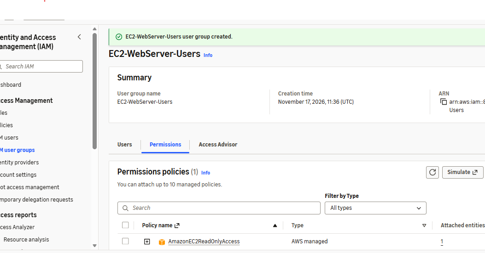

**IAM User**

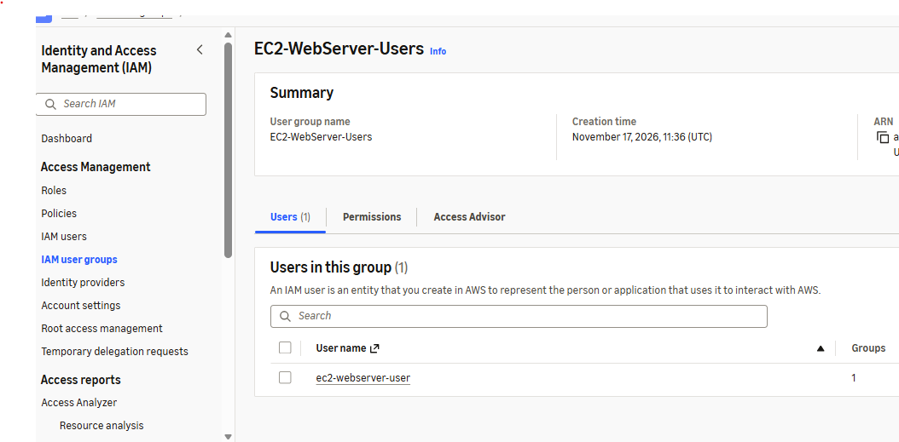

**IAM Role Trust Relationship**

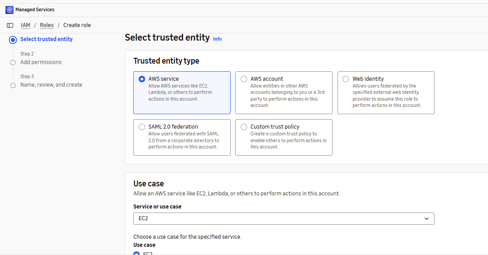

**IAM Role**

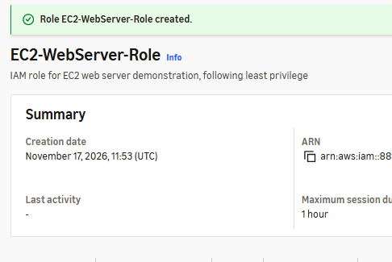

### 2. EC2 Instance Configuration

**EC2 Dashboard**

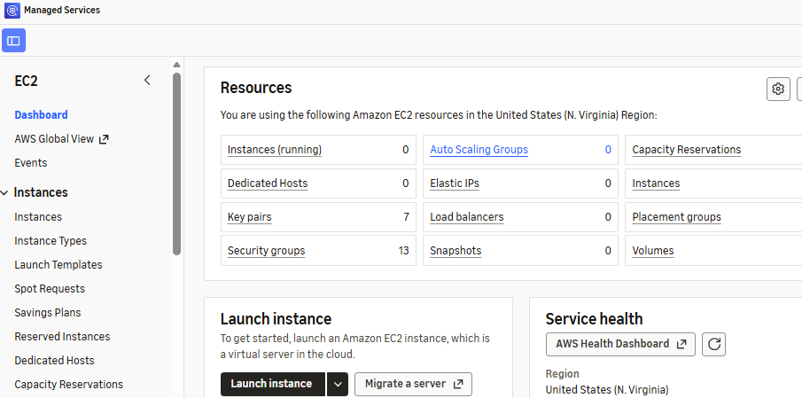

**EC2 Configuration**

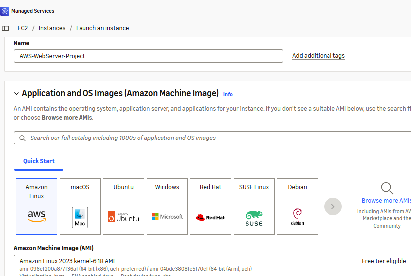

**EC2 Key Pair**

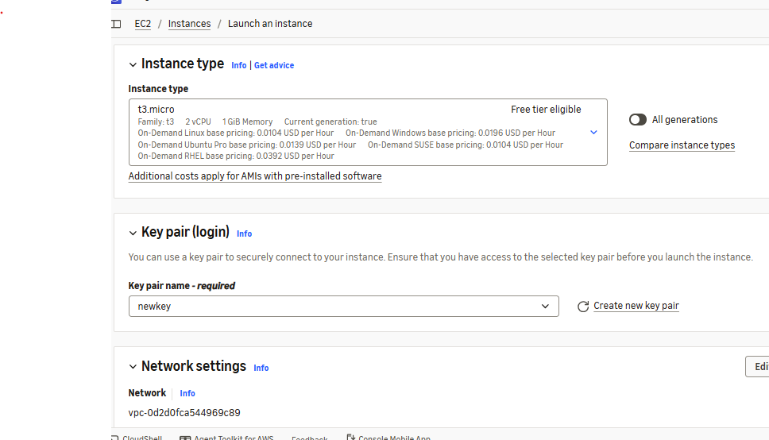

**Security Group Configuration**

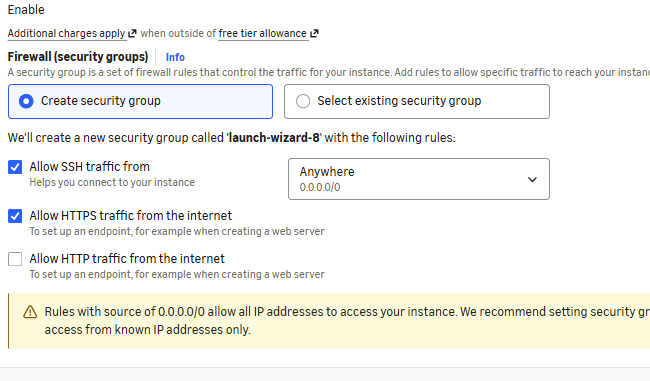

**EC2 Storage Configuration**

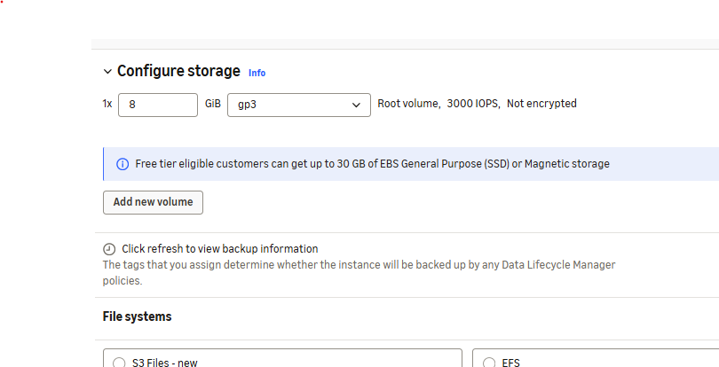

### 3. EC2 Instance and Web Server Setup

**EC2 Instance Running**

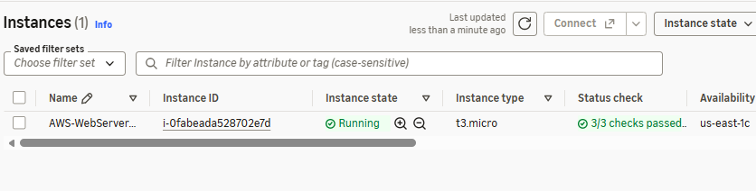

**EC2 Instance Connected**

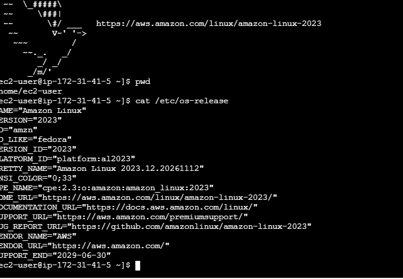

**Apache Web Server Running**

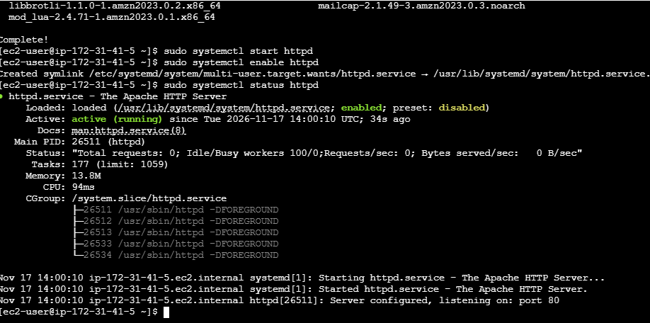

**Apache Test Page**

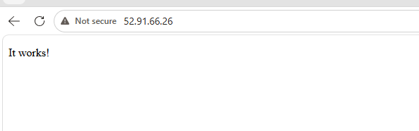

**EC2 Route Table**

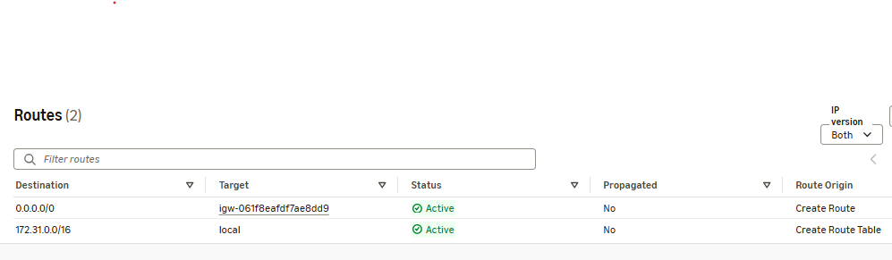

### 4. Website Deployment

**GitHub Repository Cloned on EC2**

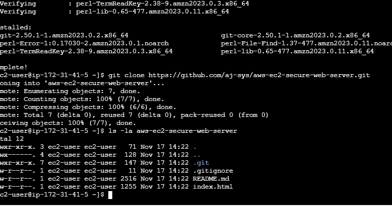

**Website Deployed to Apache**

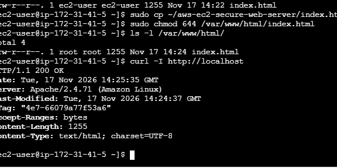

**Live AWS Website**

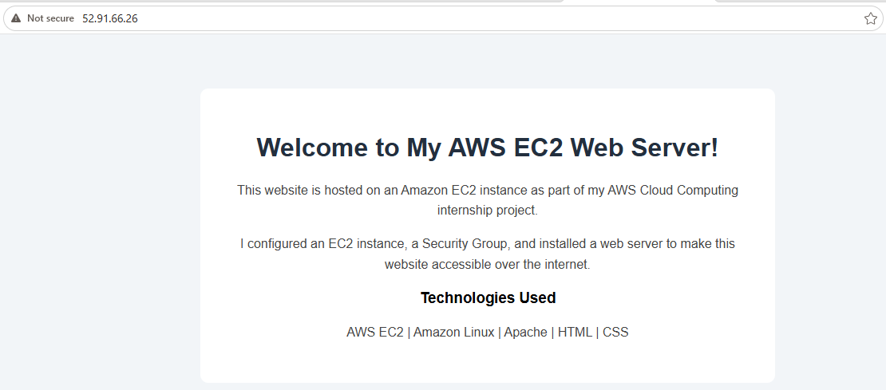

## Security Considerations

The following security practices were applied during the project:

- Used IAM groups to manage user permissions.
- Applied the AWS-managed `AmazonEC2ReadOnlyAccess` policy to the demonstration IAM group.
- Avoided generating unnecessary IAM access keys.
- Created an EC2 role with an EC2 trust relationship without attaching unnecessary permissions.
- Restricted SSH access to my IP address.
- Allowed HTTP traffic on port 80 for public website access.
- Used Linux file permissions to control access to the deployed website file.
- Used EC2 Instance Connect for browser-based server access.

**Note:** This project demonstrates foundational AWS security practices. Additional production security measures, such as HTTPS using TLS certificates, stronger administrative access controls, monitoring, and automated patch management, would be required for a production environment.

## Project Outcome

The project successfully demonstrated the deployment of a static website on an Amazon EC2 instance.

The following tasks were completed:

- IAM users, groups, and roles were created and reviewed.
- An Amazon Linux 2023 EC2 instance was launched.
- A dedicated Security Group was configured.
- The EC2 instance was accessed using EC2 Instance Connect.
- Apache was installed, started, and enabled.
- Website source code was retrieved from GitHub.
- The website was deployed to Apache's document root.
- The local Apache response was verified using `curl`.
- The live website was accessed successfully through the EC2 public IPv4 address.

## Future Improvements

Potential improvements to this project include:

- Configure HTTPS using an SSL/TLS certificate.
- Automate deployment using GitHub Actions.
- Implement AWS CloudWatch monitoring and alarms.
- Configure automated backups.
- Use Terraform to provision the infrastructure.
- Implement a more restrictive IAM policy for specific administrative tasks.

## Repository

**GitHub:** https://github.com/aj-sys/aws-ec2-secure-web-server

## Author

**Ajara Amadu**

Cloud Computing | AWS | DevOps | Cloud Security

GitHub: https://github.com/aj-sys
